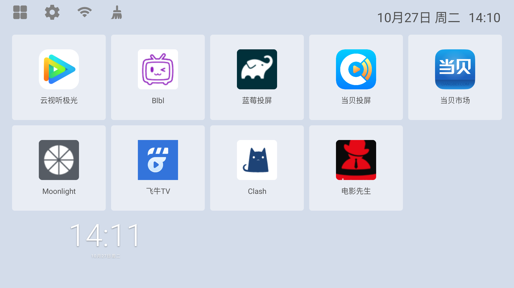
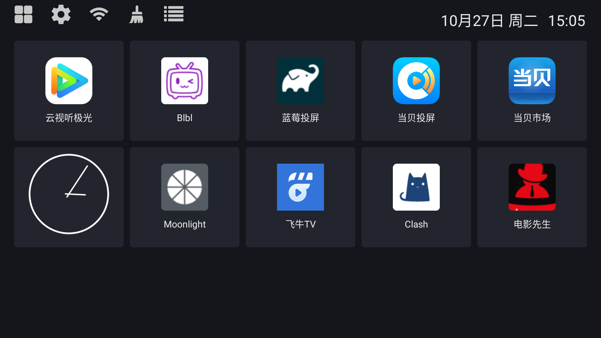
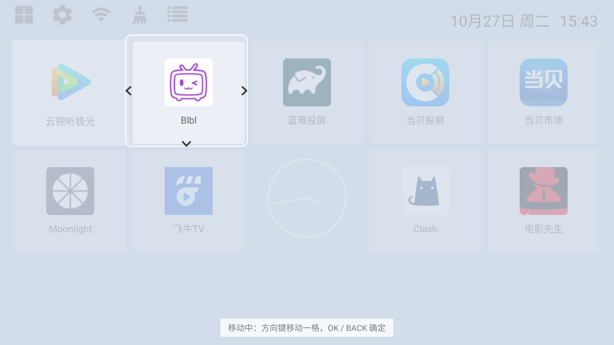
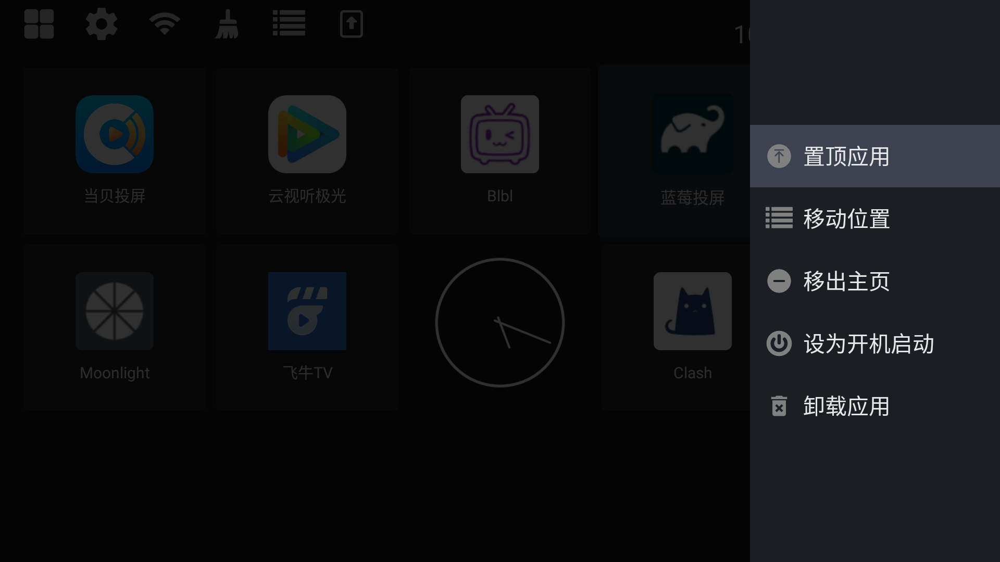
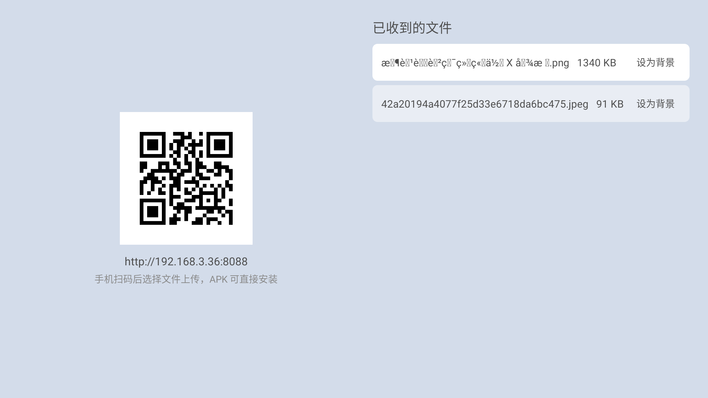
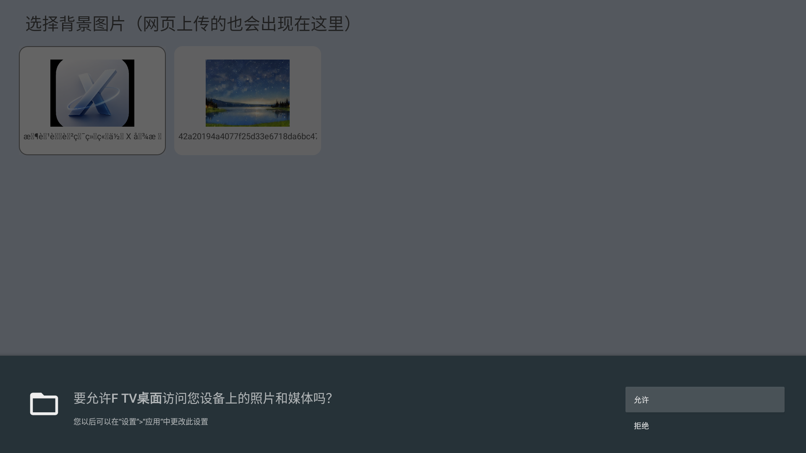

# F TV 桌面 / F TV Launcher

一个为**安卓电视盒子 / Android TV** 写的轻量桌面：极简图标网格、遥控器优先、可换背景、可放小控件、支持扫码传文件，还带局域网 SMB 浏览。

设计取向很简单：**电视是沙发上的遥控器设备**，所以每一个交互都先考虑十字键和 OK 键，而不是触摸。

```
包名：com.jerry.ftvlaunch
语言：纯 Java（无 UI 框架依赖）
体积：APK ≈ 4 MB（其中 3.6 MB 是 SMB 库 jcifs-ng）
最低系统：Android 5.0（API 21），launcher 网格要求 8.0 的密度适配
实测设备：Ugoos X4（Amlogic S905X4，Android 11，1920×1080）
```

---

## 截图

| 浅色桌面 | 深色桌面 |
|---|---|
|  |  |

| 移动位置 | 长按菜单 |
|---|---|
|  |  |

| 扫码传文件 | 图片选择器 |
|---|---|
|  |  |

---

## 功能

### 桌面
- 5 列图标网格，图标 150dp、文字 30dp
- **自由摆放**：支持空格子，可以把应用挪到任意位置；菜单里「上方留空一行」直接空出一整行，用来给小组件腾地方
- 焦点态：整格白色卡片 + 1.04 放大
- 顶栏 6 个入口：我的应用 / 设置 / 网络 / 清理 / 桌面设置 / 传文件
- 顶栏按列呼应：第一行第 N 列按 ↑ 进入第 N 个图标
- 右上角日期 + 时间，每 20 秒刷新
- 深色 / 浅色主题一键切换（设置页），桌面、抽屉、菜单、设置全部跟随

### 交互
- **长按 OK / MENU 键**打开应用菜单：置顶应用、上方留空一行、整理桌面、移动位置、移出主页、设为开机启动、卸载
- **移动位置**：编辑模式，当前格子白框 + 四向箭头、其余变暗，方向键逐格移动，OK / BACK 确定
- **开机自启**：可设延迟（5/10/15/30/60 秒），避免和系统服务抢
- 返回桌面时**保持上次选中的格子**（包括从应用、菜单返回）

### 我的应用（抽屉）
- 5 列网格，和桌面同一套格子样式
- 点击启动、长按/菜单键出菜单；置顶会把应用放到桌面第一格

### 网络
- 顶栏网络图标直接进入系统的 Wi-Fi 设置页（不再自己做详情面板，也不需要读取 Wi-Fi 名称，因此**不申请定位权限**）

### 清理
- 扫把动画 + 真实释放内存统计（不是假动画）

### 文件传输（`http://盒子IP:8088`）
- 手机扫码打开网页，**拖拽或点选**上传，支持多文件、进度条、连续上传
- 电视端列表实时刷新，每行标注可用操作：图片 →「设为背景」、APK →「安装」
- 网页端同样有按钮：图片设为背景、APK 远程安装

### 背景与小组件
- 遥控器友好的图片选择器：本机图片/APK + 网络（SMB）
- 桌面背景支持自定义图片，自动叠一层浅色蒙版保证文字可读
- 时钟等 AppWidget 小控件占一个格子，可移动、可移除、MENU 键出菜单、OK 键转发点击

### 局域网（SMB）
- 自动扫描当前 /24 网段的 SMB 主机（445 端口）
- 选择主机 → 列出共享 → 进入浏览；匿名/guest 直接进，需要账号时提示输入
- 目录显示除隐藏文件外的全部文件；图片带**缩略图**（懒加载 + 磁盘缓存）、可预览后设为背景；APK 可下载安装
- 内置**方向键可用的小键盘**（数字、qwerty、符号），不依赖系统输入法

---

## 技术要点

几个踩坑后值得记下来的地方：

1. **按 1920 设计宽度缩放**：在 `Activity.onCreate` 前把 `DisplayMetrics.density` 改成 `widthPixels / 1920`，布局里所有 dp 数值就等于 1080p 下的像素，换分辨率自动等比缩放。
2. **GridView 的选中态不可靠**：触摸模式下 `getSelectedItemPosition()` / `child.isSelected()` 都会失效，而且 GridView 布局时会重置子 View 的 selected。最终把高亮和 GridView 解耦：`AppCell.setHighlight()` 自己管，方向键也自己处理。
3. **小组件密度**：桌面改了 density，AppWidget 如果沿用会把字体算成 1px；给控件单独构造一个用系统原始密度的 `ContextWrapper`。
4. **系统输入法在盒子上不弹**（遥控器被当作硬件键盘），所以 SMB 输入用应用内自绘键盘。
5. **APK 安装**：Android 10+ 走 MediaStore Downloads + `FLAG_GRANT_READ_URI_PERMISSION`，否则 `file://` 会被系统拒绝。
6. **上传文件名编码**：multipart 头按 ISO-8859-1 读，需要再按 UTF-8 解一次，中文名才不会乱码。

---

## 构建

需要 JDK 17 和 Android SDK（compileSdk 34）。

```bash
git clone <your-repo-url> ftv2
cd ftv2
echo "sdk.dir=$HOME/Library/Android/sdk" > local.properties
./gradlew assembleDebug
```

产物：`app/build/outputs/apk/debug/app-debug.apk`

> 如果本机 `~/.gradle/gradle.properties` 里配了失效代理导致依赖下载失败，可以临时换一个 GRADLE_USER_HOME：
> `GRADLE_USER_HOME=/tmp/gh ./gradlew assembleDebug`

## 安装

```bash
adb connect 192.168.x.x:5555
adb install -r app-debug.apk
adb shell cmd package set-home-activity com.jerry.ftvlaunch
```

想换回原桌面：`adb shell cmd package set-home-activity <原桌面包名>`

---

## 目录结构

```
app/src/main/java/com/jerry/ftvlaunch/
├── MainActivity.java        桌面：网格、顶栏、移动模式、网络面板
├── AllAppsActivity.java     我的应用
├── MenuActivity.java        长按菜单（平铺列表 + 滑入）
├── AppCell.java             应用格子（hover / 移动态状态机）
├── WidgetCell.java          小组件格子
├── ArrowsView.java          移动模式方向箭头（Canvas 自绘）
├── ImagePickerActivity.java 图片 / APK / SMB 浏览器
├── SmbSetupActivity.java    SMB 地址设置（含内置键盘、扫码发现）
├── FileTransferActivity.java 扫码传文件 + 网页服务
├── MiniHttpServer.java      极简 HTTP 服务（上传页 / 文件列表 / 动作接口）
├── SmbBrowser.java          jcifs-ng 封装
├── CleanActivity.java       清理动画
├── SettingsActivity.java    桌面设置
├── Theme.java               深/浅色取色中心
├── AppRepo / HomeStore / Widgets / Wallpaper / Boot* …
└── …
```

## 已知限制

- 小组件占一个格子，不支持 2×2 或多控件自由布局
- 网络信息交给系统设置页，桌面内不显示 SSID/信号
- SMB 只做了浏览、缩略图、下载、安装，不做上传/删除/重命名
- 只测过 Ugoos X4 一台设备，其他盒子的固件差异（尤其国行/白牌）可能需要调
- 空格子会占满一行高度，留空行多了需要滚动
- 开机自启是拉起应用，部分 App 可能会被系统拉回桌面

## Roadmap

- [ ] 小组件支持多格 / 自由布局
- [ ] SMB 上传、重命名
- [ ] 应用抽屉支持分类 / 搜索
- [ ] 遥控器自定义按键映射
- [ ] 多语言（当前中文为主）

## License

MIT，见 [LICENSE](LICENSE)。
